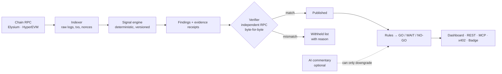

<p align="center">
  <picture>
    <source media="(prefers-color-scheme: dark)" srcset="public/logo-light.svg">
    
  </picture>
</p>

<h3 align="center">The integrity and readiness layer for Ascend launches on Elysium.</h3>

<p align="center">
  Know who is really holding. Separate real participants from coordinated activity.<br>
  Get a Go / Wait / No-go verdict, with evidence anyone can re-fetch from chain state.
</p>

<p align="center">
  <a href="https://ascendlaunch.gitbook.io/docs">Ascend docs</a> ·
  <a href="https://elysium.kinetiq.xyz/docs">Elysium docs</a> ·
  <a href="#judge-guide">Judge guide</a> ·
  <a href="#api-mcp-and-x402">API, MCP and x402</a> ·
  <a href="#roadmap">Roadmap</a>
</p>

---

## The problem

Ascend decides which launched tokens become **Ascended** using market capitalization, unique holders, volume, and checks for concentrated or coordinated accumulation. Buyback allocations are weighted by unique holders, weighted volume over time, and market cap. The thresholds are internal and some rules are at team discretion. That leaves four gaps:

| Who | Gap |
| --- | --- |
| **Builders** | Cannot see where they stand against Ascended, or what to fix. |
| **Traders** | Cannot easily tell organic volume from wash trading, or real holders from one operator running many wallets. |
| **HYPE stakers** | Receive ecosystem-token exposure with no independent check on what they hold. |
| **AI agents** | Have no machine-readable, verifiable safety check for fresh launches before they trade or allocate. |

## What Ascertain does

Paste a token. Ascertain indexes its raw logs, merges wallets that are clearly linked, measures concentration, volume quality and wallet age, and returns a verdict for where the token stands in the Ascend lifecycle (Launch → Ascended → HyperCore spot → HIP-3 perps).

```text
Mirage (MIRA)    412 raw holders  →  38 effective holders     NO-GO
                 4 funding clusters (200 / 110 / 48 / 20 wallets), 28 synchronized entry batches
                 Hard rule: effective / raw = 0.09  (estimated hard limit 0.50)
```

### What makes it different

| | |
| --- | --- |
| **Evidence-first publishing** | A finding is published only if every fact it cites re-fetches from chain state through an independent RPC and matches byte for byte. Failures are *withheld* and listed publicly, with the reason. Remove the verifier and nothing is published. |
| **Rules in code, AI only advises** | Verdicts come from deterministic, versioned rules. Optional AI commentary can downgrade a verdict to WAIT or NO-GO. It can never upgrade one. |
| **Effective holders, not raw holders** | Wallets are merged by shared funding source, same-block entry and wash loops before counting, so one operator cannot look like 400 people. |
| **Built for Ascend's lifecycle** | Maps to the published criteria and shows what is known and unknown at every stage. |
| **Agent-native and monetized** | MCP server, REST + OpenAPI, and x402 pay-per-answer from the first release. |
| **Honest about limits** | Scores are labelled estimates. Methodology and known blind spots are public. |

## Deployed on Elysium testnet

Three mock launches are deployed on **Elysium testnet (chain 99801)** with real contracts, real funding trees and real swaps, then indexed from chain logs. All 717 logs and funding transactions were re-fetched from the testnet RPC and matched byte for byte (`npm run verify:all`).

| Token | Pattern | Token contract | Pool | Indexed |
| --- | --- | --- | --- | --- |
| LUMT | clean | [`0xa37942e9…c05143`](https://elysium.kinetiq.xyz/address/0xa37942e9963d7e036f2b9e6d15c1597541c05143) | [`0x61601c6d…f1c366`](https://elysium.kinetiq.xyz/address/0x61601c6dfe0fede9f98c75ebd484a70683f1c366) | 140 logs, 68 funding txs |
| WAVT | wash-traded | [`0xef137361…783bfb`](https://elysium.kinetiq.xyz/address/0xef1373618f42ff341f3a95acf279aaadd3783bfb) | [`0x67818b9c…da1d91`](https://elysium.kinetiq.xyz/address/0x67818b9cf6d6969b04b206de95b4c9bdedda1d91) | 278 logs, 47 funding txs |
| MIRT | sybil-clustered | [`0x1b22e5b8…a3a580`](https://elysium.kinetiq.xyz/address/0x1b22e5b8d76b56884853bf5fe09ee697c9a3a580) | [`0x7bc751ca…145385`](https://elysium.kinetiq.xyz/address/0x7bc751ca934e5939e929a394fbe1efb8a5145385) | 118 logs, 66 funding txs |

LUMT → **GO**, WAVT → **NO-GO** (wash loops), MIRT → **NO-GO** (56 raw holders → 9 effective). The pool is a mock of Ascend's closed hook pools (`contracts/`), not Ascend's contracts. Reproduce: `npm run plant` (needs a funded testnet key), `npm run verify:testnet`, `npm run verify:all`. Growth bars for these tiny launches use a clearly labelled `testnet-scale` threshold profile; integrity rules are not scaled.

## Results

Back-test on five seeded Elysium-testnet launches with **planted ground truth** (`npm run backtest`, output in [`evidence/`](evidence)):

| Token | Scenario | Verdict | Raw → effective holders | Planted clusters found | Wash wallets found | Withheld by verifier |
| --- | --- | --- | --- | --- | --- | --- |
| LUMEN | clean, organic | **GO** | 424 → 422 | 1/1 (a 3-wallet family group) | 0 / 0 | 0 |
| RISE | early stage | **WAIT** | 106 → 106 | n/a | n/a | 0 |
| HOLD | concentrated | **NO-GO** | 89 → 89 | n/a | n/a | 1 |
| WAVE | wash-traded | **NO-GO** | 171 → 171 | 2/2 (funding groups) | 12 / 12 | 1 |
| MIRA | clustered | **NO-GO** | 412 → 38 | 4/4 | n/a | 1 |

Totals: verdicts correct 5/5 · planted clusters found 7/7 · planted wash wallets found 12/12 · **0 false-positive clusters or wash wallets on clean tokens** · effective-holder error 0.

> **Read this honestly.** These launches are simulated, so the answer is known. The numbers show that each signal finds the pattern planted in it and leaves a clean token alone. They are not a claim about accuracy on real tokens. The replay CLI (`npm run replay`) runs the engine and verifier on real HyperEVM tokens; real-token results will be published only after they are run.

## How it works



**Signals** (all in [`src/engine/signals.ts`](src/engine/signals.ts)): concentration (top-1/5/10, HHI, Gini), funding-source clusters (shared first funder within N hops, exchange hot wallets ignored), same-block entry, wash loops (paired round trips and wallet-to-wallet token cycles), wallet age and activity, effective holders, volume per unique wallet (organic vs inflated), market cap.

**Evidence receipts.** Every finding stores chain id, block, address, tx hash or call data, the raw returned value and the rule version. Each receipt carries a copy-paste `cast` command:

```bash
cast call <token> 0x70a08231…<holder> --block <n> --rpc-url https://testnet-rpc.elysium.kinetiq.xyz
```

**Verdict logic.** Any hard failure → NO-GO. All rules passing on verified evidence → GO. Anything else, including a rule whose evidence was withheld → WAIT. Three intents choose the rule set: *creator* (am I ready for Ascended?), *trader* (is activity organic?), *staker* (what am I exposed to?). Thresholds live in [`config/thresholds.v1.json`](config/thresholds.v1.json), are shown in the UI, and are labelled estimates.

## Product surface

- **Dashboard**: token list with verdict badges and search, token page (verdict, score breakdown, holder concentration, linked-wallet graph, volume per wallet, evidence, withheld list), creator dashboard (lifecycle tracker, gap to Ascended, revenue and listing-reserve planner), public methodology page. Responsive, dark and light themes.
- **Verified badge**: `/api/badge/<symbol>.svg`, turns stale-gray when its data is older than the limit.
- **Public withheld list**: `/withheld`.

## API, MCP and x402

```text
GET  /v1/token/{address}/readiness   verdict + score       $0.01  (25 free / IP / day)
GET  /v1/token/{address}/integrity   signals + clusters    $0.05
GET  /v1/evidence/{findingId}        receipts + reproduce  free
POST /v1/preflight                   verdict for an intent, with advisory commentary
```

OpenAPI at `/openapi.json`, agent card at `/.well-known/agent-card.json`.

**MCP** (stdio): tools `ascertain_check_token`, `ascertain_readiness`, `ascertain_verify_finding`.

```bash
claude mcp add ascertain -e ASCERTAIN_URL=https://<deployment> -- npx -y ascertain-mcp
```

**x402.** Paid endpoints answer `402` with payment requirements (scheme `exact`, USDC, EIP-3009). The client signs an authorization and retries with `X-PAYMENT`. Two modes: *facilitator* (set `X402_PAY_TO`, settles through an x402 facilitator) and *demo* (default: signature verified locally, **no funds move**). `/agents` runs the whole flow live; `npm run x402:demo` does it from a terminal. Network and facilitator are configurable (default `base-sepolia`); pricing is a proposal.

## Judge guide

| Question | Where |
| --- | --- |
| Paste a token, get a verdict with evidence | `/token/MIRA`, `/token/LUMEN` (live app) |
| "Delete the verifier and nothing is published" | `/token/MIRA?verifier=off`, `tests/engine.test.ts` |
| Withheld list | `/withheld` |
| Each signal's code | [`src/engine/signals.ts`](src/engine/signals.ts) (`concentration`, `fundingClusters`, `sameBlockEntry`, `washLoops`, `walletAge`, `effectiveHolders`, `volumePerWallet`, `marketCap`) |
| Verifier | [`src/engine/verifier.ts`](src/engine/verifier.ts) |
| Verdict rules and the AI downgrade-only guard | [`src/engine/readiness.ts`](src/engine/readiness.ts) |
| Back-test numbers and evidence JSON | `npm run backtest` → [`evidence/`](evidence) |
| MCP server | [`mcp/server.mjs`](mcp/server.mjs) |
| x402 | [`src/x402/index.ts`](src/x402/index.ts), `/agents` |
| Methodology and blind spots | `/methodology` |

## Run it locally

```bash
npm install
npm run dev          # http://localhost:3000
npm test             # fixtures prove signals find planted patterns and the clean token stays clean
npm run backtest     # regenerates evidence/
```

Copy `.env.example` to `.env.local` to configure RPCs, x402 and optional AI commentary. A `Dockerfile` and `vercel.json` are included.

## Repository layout

```text
src/engine      signals, verifier, readiness rules, evidence receipts
src/chain       codec, RPC source (viem), read-only token probe
src/fixtures    seeded launches with planted ground truth, independent chain replica, back-test
src/x402        pay-per-answer (verify, settle, client signing)
src/app         Next.js app: dashboard, API routes, badge, agent card
mcp/            MCP server (stdio)
contracts/      Foundry mock launch contracts
config/         versioned threshold config (estimates)
evidence/       back-test summary and per-finding evidence JSON
```

## Honest limits

- **Ascend's thresholds are internal.** Ours are estimates from public criteria, configurable and labelled. Nothing here is an official Ascend decision.
- **Elysium mainnet is pre-launch** with no published date. Ascertain ships against the testnet chain model; mainnet is a roadmap milestone. HyperCore precompiles are not depended on.
- **Five more launches on the site are simulated** and labelled as such; three launches are on-chain on Elysium testnet. Ascend hook-pool addresses and interface are not yet available to us; the adapter plugs in once published. On-chain receipts are recorded from the testnet RPC (same provider as the indexer; an independent second provider is not yet configured) and can be re-verified live with `?live=1`.
- **Replay on real tokens** is implemented for the ERC-20 adapter (concentration + verification) but not yet run for published results.
- **Receipts verify a sample** of cited facts plus a digest; derived metrics are recomputed deterministically from stored raw logs.
- **No audit is claimed.** Findings describe observable on-chain patterns, never intent. Clusters are shown as "linked by funding source".
- Known blind spots (market-maker bots, new shared infrastructure, careful operators) are listed on `/methodology#blind-spots`.

## Roadmap

1. **Now (testnet MVP):** indexer, signal engine, verifier, dashboard, REST, MCP, x402, badge, planner.
2. **Next:** Ascend hook-pool adapter once addresses and interface are available; deploy mock launches to Elysium testnet; public analyses of real HyperEVM tokens via replay; alerts (creator readiness changes, trader NO-GO flips).
3. **Mainnet:** launch through Ascend at Elysium mainnet; free verdict tier, paid API, badge adoption by launched projects.
4. **After HyperCore precompiles ship (~4 weeks after mainnet):** read HyperCore state directly for spot and HIP-3 readiness signals.

## Token plan

Recipients of the Builder Program launch through Ascend. The intended utility is simple: holding or staking the token discounts paid API calls and unlocks higher rate limits, while creator fee share (if Ascend approves Ascertain as an active creator) funds data and RPC costs. No returns or price outcomes are promised anywhere. Legal and compliance review for the relevant jurisdictions comes before any launch.

## Security and privacy

Read-only chain access. No custody: Ascertain never holds funds or keys and never signs transactions for users. No private user data is stored. Secrets live in environment variables. Public API is rate limited. See [SECURITY.md](SECURITY.md).

## License

[MIT](LICENSE). Not affiliated with Kinetiq or Ascend.
